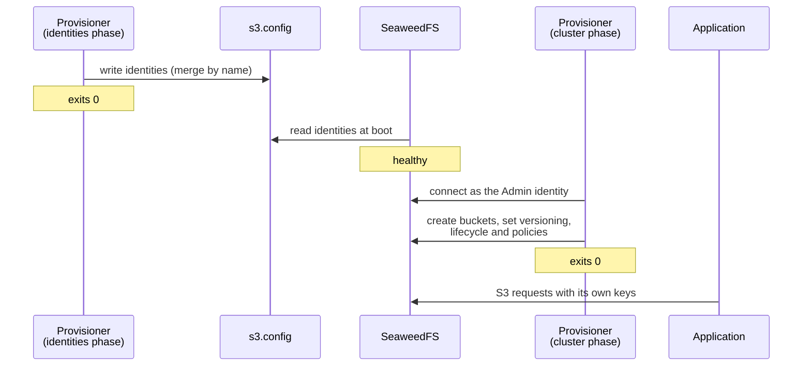

# How it works

The [getting started guide](getting-started.md) showed *what* the provisioner does. This page
explains *how* a run works, so its behavior holds no surprises when you rely on it in
production.

## Two phases

The provisioner manages two kinds of things, and they need SeaweedFS in opposite states:

- **Identities** are written into `s3.config`, a JSON file the SeaweedFS S3 gateway reads
  **once, at boot**. They have to be in place *before* SeaweedFS starts.
- **Buckets** (with their versioning and lifecycle rules) and **bucket policies** are created
  over the S3 API. They need SeaweedFS *running*.

That's why a run is split into phases, selected with `--phase` or `SEAWEEDFS_PHASE`:

| Phase | Provisions | Needs | Typical place |
|---|---|---|---|
| `identities` | identities → `s3.config` | write access to the file, no cluster | before SeaweedFS starts |
| `cluster` | buckets, then policies | a running, healthy SeaweedFS | after SeaweedFS is healthy |
| `all` (default) | both, in that order | a running SeaweedFS | only when you restart SeaweedFS afterwards |

This is the order a deployment runs them in:



The `cluster` phase can only log in because the `identities` phase ran first: once
`s3.config` holds any identity, SeaweedFS rejects anonymous requests. So the config needs an
identity with the `Admin` action, and the `cluster` phase uses its keys
(`SEAWEEDFS_ACCESS_KEY`, `SEAWEEDFS_SECRET_KEY`).
[Set up the admin identity the provisioner logs in with](howto/set-up-the-admin-identity.md)
covers this.

`all` runs both phases in one process against a cluster that is already up. The identities
it writes reach SeaweedFS only on its next restart. In Docker Compose and Kubernetes, run the
phases as two separate containers instead; [Deployment](deployment.md#docker-compose) shows
both setups.

## Why identities are a file

SeaweedFS has no runtime API for the identity model the provisioner uses (a `name`,
`credentials` and a list of `actions`). That model *is* the schema of the static `s3.config`
file, so writing that file is the only way to provision it.

SeaweedFS does ship a separate IAM (Identity and Access Management) server, `weed iam`. It
speaks the AWS IAM query protocol, and its model is different: users, access keys and policy
documents, not names with action lists. The filer has no identity endpoint either.

The consequence you notice in practice: **identity changes take effect when SeaweedFS
restarts, not while it is running**. Adding an identity, changing its actions or rotating a
key means rendering the file and then restarting the S3 gateway.
[Change identities on a running cluster](howto/change-identities-on-a-running-cluster.md)
walks through it.

The file holds secret keys in plain text and is written with mode `0644` by default, because
SeaweedFS reads it as an unprivileged user.
[s3.config file permissions](deployment.md#s3config-file-permissions) explains why and how to
tighten it.

## A run, from start to finish

1. **Choose the phase.** `--phase` wins over `SEAWEEDFS_PHASE`; without either, the phase is
   `all`. An unknown value stops the run with exit code `1`.
2. **Load the config.** The YAML file is parsed, `${VAR}` references are resolved, and the
   **whole** config is validated, in every phase. The `identities` phase rejects a bad bucket
   name, and the `cluster` phase rejects an identity without credentials. Every problem is
   reported with its path, such as `buckets[1].name`. Nothing has been written or contacted
   yet. See [Validation](configuration.md#validation).
3. **Prepare what the phase needs.** For `identities` and `all`, if the config declares
   identities, `SEAWEEDFS_S3_CONFIG_PATH` must be set; the `identities` phase never connects
   to SeaweedFS. For `cluster` and `all`, the provisioner connects to the S3 gateway and
   retries with backoff for up to 5 minutes; see
   [Connection retry](deployment.md#connection-retry).
4. **Provision.** Identities first (`all` and `identities`), then buckets in config order,
   then policies in config order (`all` and `cluster`). Policies come last because they
   attach to buckets.
5. **Exit** with code `0` on success, or `1` at the first error. Nothing is rolled back, and
   nothing needs to be: fix the cause and run again. See [Exit codes](deployment.md#exit-codes).

One consequence of step 3 for `all`: the connection to SeaweedFS is made **before** any
identity is written. If SeaweedFS is unreachable, the run fails after the retry budget and
`s3.config` stays untouched.

## Additive by design

The provisioner reconciles what's **in** the config and leaves everything else alone:

| You remove… | What happens |
|---|---|
| a bucket | Nothing. The bucket and its objects stay. |
| an identity | Nothing. Its entry stays in `s3.config`. |
| a policy entry | Nothing. The policy stays on the bucket. |
| a lifecycle rule | Nothing. The rule stays on the bucket; set `status: disabled` to turn it off. |
| `versioning` from a bucket | Nothing. The bucket keeps its current versioning state. |

This is deliberate. A typo or a forgotten line must not delete a bucket full of data or lock
out a service. The other side: the config describes a **minimum**, not the exact state.
Buckets, identities and rules created by hand or by another tool are left alone, including
the admin identity in `s3.config` if you created it outside the config.

There are three places where something *does* disappear, because an entry is rewritten as a
whole:

- **A credential or action removed from an identity that is still in the config** is gone
  from `s3.config` after the next `identities` run. The provisioner replaces the identity's
  whole entry. That's what makes key rotation work; see
  [Rotate an access key without downtime](howto/rotate-an-access-key.md).
- **Fields the provisioner doesn't know on any identity** are dropped whenever it writes the
  file. It keeps only `name`, `credentials` (`accessKey`, `secretKey`) and `actions` for every
  identity in the list, including identities it doesn't manage. Unknown fields at the top
  level of the file, such as `accounts`, are kept.
- **Lifecycle rule elements other than ID, prefix, expiration in days and status** are dropped
  when the provisioner writes a bucket's lifecycle configuration. This affects rules that
  aren't in the config too, for example a rule with transitions or a tag filter added by hand.
  See [Lifecycle rules](configuration.md#lifecycle-rules).

## What "update" means for each resource

With the default `strategy: update`, each resource in the config is reconciled like this:

| Resource | On every run |
|---|---|
| Identity | Written to `s3.config`, every time, without comparing first. The entry with the same `name` is replaced; if there is none, it's appended. Other identities and other top-level fields stay. |
| Bucket | Created if missing. |
| Versioning | Not touched if `versioning` is omitted. `true`: enabled unless already enabled. `false`: suspended only if currently enabled. |
| Lifecycle | Not touched if `lifecycle` is empty or omitted. Otherwise the current rules are read, merged with the configured ones by `id`, and written only if the result differs. |
| Policy | The file is read and checked to be valid JSON, then compared with the bucket's current policy; written only if they differ. |

The details behind the table:

- **`s3.config` is merged, not overwritten.** The provisioner reads the file, replaces or
  appends the configured identities by name and writes the result back. That's what keeps
  the admin identity in place when it isn't in the config. The write is atomic (temporary
  file, then rename), so a booting SeaweedFS never reads a half-written file. A missing file
  is created, including its directory.
- **Versioning has three states, not two.** Omitting `versioning` leaves the bucket alone.
  `false` suspends versioning only when the bucket reports `Enabled`; a bucket that was never
  versioned stays that way, since there is nothing to suspend. See
  [Versioning](configuration.md#versioning).
- **Lifecycle rules merge by `id`.** S3 replaces a bucket's whole lifecycle configuration on
  every write, so the provisioner carries the rules it doesn't manage across. The comparison
  ignores rule order and accepts the prefix in either place SeaweedFS reports it, so an
  unchanged configuration isn't rewritten.
- **Policy drift ignores whitespace, and nothing else.** Both documents are compacted before
  comparing, so reformatting the file doesn't cause a write. Any other textual difference
  does, even when the policy means the same: a different key order, different string
  escaping, or a form SeaweedFS normalizes when it stores the policy. SeaweedFS returns a
  single-element `Action` or `Resource` list as a plain string, for example, so a file that
  writes `"Action": ["s3:GetObject"]` is seen as drifted and rewritten on every run. A
  rewrite of an identical policy is harmless, but it shows up as `Setting bucket policy` in
  every log and as `Would set bucket policy` in every dry-run. A bucket without a policy always gets one. See
  [Control bucket access with a policy](howto/control-bucket-access-with-a-policy.md).

The run stops at the first error, so a failing bucket stops the buckets after it and all
policies.

## Strategy: update or create

`strategy` decides what happens to **buckets that already exist**:

- **`update`** (default): reconcile them as described above.
- **`create`**: leave them exactly as they are, including their versioning and lifecycle
  rules. Only missing buckets are created, and a new bucket still gets its configured
  settings.

`create` fits a bucket the provisioner should set up once and then hand over, for example
one whose lifecycle rules an operator tunes by hand afterwards. The strategy can be set
globally and overridden per bucket:

```yaml
strategy: create            # default for every bucket below

buckets:
  - name: shop-archive      # created once, never reconciled afterwards
    lifecycle:
      - id: expire-old-archives
        expiration_days: 365
  - name: shop-uploads
    strategy: update        # always reconciled
    versioning: true
```

An existing bucket under `create` logs `Skipping existing bucket and its settings
(strategy=create)`. Strategy applies to buckets only: identities are always written, and
policies are always compared with their file.

## Dry-run

`--dry-run` (or `DRY_RUN=true`) runs the phase, but every change is **logged** with a
`Would …` message instead of made. The `--dry-run` flag wins over `DRY_RUN`, so
`--dry-run=false` turns off a dry-run set in the environment.

The two phases preview differently:

- **The `cluster` phase reads live state.** It connects, checks which buckets exist, and reads
  their versioning, lifecycle and policy, so the preview lists only what would change. A
  second dry-run after applying logs no `Would …` lines.
- **A new bucket can't be read.** If the bucket doesn't exist yet, the preview logs
  `Would create bucket`, followed by `Would set bucket versioning` and
  `Would set bucket lifecycle` for the settings the config asks for.
- **The `identities` phase doesn't read `s3.config`.** It logs `Would write identity` for
  every identity in the config, changed or not, with the number of credentials and actions.
  It still needs `SEAWEEDFS_S3_CONFIG_PATH` set, but it doesn't touch the file.

```json
{"level":"INFO","msg":"Would set bucket versioning","bucket":"shop-uploads","current":"","enabled":true}
{"level":"INFO","msg":"Would create bucket","bucket":"shop-exports"}
{"level":"INFO","msg":"Would set bucket lifecycle","bucket":"shop-exports","rules":1}
{"level":"INFO","msg":"Would write identity","name":"shop-app","credentials":1,"actions":3}
```

Policy files are read and checked in a dry-run too, so a missing or invalid file fails the
preview the same way it would fail the real run.

## Logs

Logs are JSON lines on stdout, one per action, each with `time`, `level` and `msg` plus the
fields of that action. `LOG_LEVEL` sets the level: `debug`, `warn` or `error`, in lower case;
anything else, including unset, means `info`.

At `info`, a run logs what it **does**. What it **skips** because nothing changed is logged
at `debug` only:

| Level | Messages |
|---|---|
| `INFO` | `Starting seaweedfs-provisioner`, `Configuration loaded` (with phase and counts), `Connected to SeaweedFS S3`, `Writing identity`, `Identity written`, `Creating bucket`, `Setting bucket versioning`, `Setting bucket lifecycle`, `Setting bucket policy`, `Skipping existing bucket and its settings (strategy=create)`, `Would …` in a dry-run, `seaweedfs-provisioner finished successfully` |
| `DEBUG` | `Bucket already exists`, `Bucket versioning up to date`, `Bucket lifecycle up to date`, `Bucket policy up to date`, `No identities configured, skipping identity phase` |
| `WARN` | `SeaweedFS S3 not ready, retrying` (with attempt, delay and error) |
| `ERROR` | `Provisioning failed` (with the error), `Invalid phase`, `Invalid dry-run setting` |

An unchanged run at `info` is therefore short: start, configuration, connection, finish.
Identity lines carry the identity name and counts, never keys.

## Next steps

- [Configuration reference](configuration.md) lists every field.
- [Deployment](deployment.md) covers Docker Compose, Kubernetes, environment variables and
  exit codes.
- [Set up the admin identity the provisioner logs in with](howto/set-up-the-admin-identity.md)
  and the other how-tos apply this to concrete tasks.
- [FAQ](faq.md#day-to-day-behavior) answers the questions that come up once it runs in
  production.
