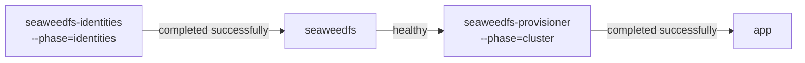

# Deployment

The provisioner is a short-lived process: it makes SeaweedFS match the config and exits, `0` on
success and `1` on any error. Because identities have to exist before SeaweedFS starts and
buckets need SeaweedFS running, a deployment usually runs it twice: once before SeaweedFS with
`--phase=identities`, and once after with `--phase=cluster`. See
[Two phases](concepts.md#two-phases).

- [Image tags](#image-tags)
- [Docker Compose](#docker-compose)
- [Kubernetes](#kubernetes)
- [Standalone binary](#standalone-binary)
- [Environment variables](#environment-variables)
- [CLI flags](#cli-flags)
- [Connection retry](#connection-retry)
- [s3.config file permissions](#s3config-file-permissions)
- [Exit codes](#exit-codes)

## Image tags

Images are published to `ghcr.io/datarocks-ag/seaweedfs-provisioner` for `linux/amd64` and
`linux/arm64`. Per the release workflow (`.github/workflows/release.yaml`), these tags exist:

| Tag | Points to | Use it for |
|---|---|---|
| `1.0.0` | exactly that release | production: reproducible |
| `1.0` | latest patch release of 1.0 | production: picks up fixes |
| `latest` | latest release | trying things out |
| `develop` | the `develop` branch | testing unreleased changes |
| `sha-<commit>` | a single commit | debugging |

There is no major-only tag such as `1`. Pin `1.0` or `1.0.0`; the examples on this page use `1.0`.

The documentation on the `develop` branch may describe features that aren't released yet; the
[changelog](../CHANGELOG.md) lists them under *Unreleased*.

The image is built `FROM scratch`: it contains the static binary and the CA (certificate
authority) bundle, nothing else, so there is no shell to `exec` into. It sets no user, so the
provisioner runs as root (uid 0) unless you set one. It sets no working directory either, so
the working directory is `/`: the default config path `./config.yaml` is `/config.yaml`, and a
policy `file: policies/x.json` is `/policies/x.json`.

## Docker Compose

The full setup has four services that start in order: the identities phase renders `s3.config`
into a shared volume, SeaweedFS starts from it, the cluster phase creates buckets and policies,
and only then does the application start.



`config.yaml` declares the admin identity that the cluster phase logs in with, next to the
application's identity:

```yaml
buckets:
  - name: documents
    versioning: true

identities:
  # The provisioner's own login for the cluster phase.
  - name: admin
    credentials:
      - access_key: ${SEAWEEDFS_ADMIN_ACCESS_KEY}
        secret_key: ${SEAWEEDFS_ADMIN_SECRET_KEY}
    actions: ["Admin", "Read", "Write", "List", "Tagging"]

  - name: app-service
    credentials:
      - access_key: ${APP_SERVICE_ACCESS_KEY}
        secret_key: ${APP_SERVICE_SECRET_KEY}
    actions: ["Read:documents", "Write:documents", "List:documents"]

policies:
  - bucket: documents
    file: policies/documents-policy.json
```

`policies/documents-policy.json` lets `app-service` work with the bucket. SeaweedFS matches
identities in policies only in the form `arn:aws:iam::000000000000:user/<identity-name>`; see
[Policies](configuration.md#policies).

```json
{
  "Version": "2012-10-17",
  "Statement": [
    {
      "Sid": "AppServiceReadWriteDocuments",
      "Effect": "Allow",
      "Principal": { "AWS": "arn:aws:iam::000000000000:user/app-service" },
      "Action": ["s3:ListBucket", "s3:GetObject", "s3:PutObject", "s3:DeleteObject"],
      "Resource": ["arn:aws:s3:::documents", "arn:aws:s3:::documents/*"]
    }
  ]
}
```

The `compose.yaml`:

```yaml
services:
  # Phase 1: runs before SeaweedFS exists and renders s3.config.
  seaweedfs-identities:
    image: ghcr.io/datarocks-ag/seaweedfs-provisioner:1.0
    command: ["--phase=identities"]
    environment:
      SEAWEEDFS_CONFIG_PATH: /config.yaml
      SEAWEEDFS_S3_CONFIG_PATH: /seaweedfs-config/s3.json
      SEAWEEDFS_ADMIN_ACCESS_KEY: admin-key
      SEAWEEDFS_ADMIN_SECRET_KEY: admin-secret
      APP_SERVICE_ACCESS_KEY: app-service-key
      APP_SERVICE_SECRET_KEY: app-service-secret
    volumes:
      - ./config.yaml:/config.yaml:ro
      - seaweedfsconfig:/seaweedfs-config

  seaweedfs:
    image: chrislusf/seaweedfs:latest
    command: server -s3 -filer -s3.config=/seaweedfs-config/s3.json
    depends_on:
      seaweedfs-identities:
        condition: service_completed_successfully
    ports:
      - "8333:8333"
    volumes:
      - seaweedfsdata:/data
      - seaweedfsconfig:/seaweedfs-config:ro
    healthcheck:
      # SeaweedFS listens on the container IP, not on localhost, and answers
      # anonymous requests with 403 once identities exist.
      test: ["CMD-SHELL", "wget -q --spider -S http://$$(hostname -i):8333/ 2>&1 | grep -qE 'HTTP/1.[01] (200|403)'"]
      interval: 5s
      timeout: 5s
      retries: 20

  # Phase 2: buckets and policies against the running gateway.
  seaweedfs-provisioner:
    image: ghcr.io/datarocks-ag/seaweedfs-provisioner:1.0
    command: ["--phase=cluster"]
    depends_on:
      seaweedfs:
        condition: service_healthy
    environment:
      SEAWEEDFS_S3_ENDPOINT: http://seaweedfs:8333
      SEAWEEDFS_CONFIG_PATH: /config.yaml
      SEAWEEDFS_ACCESS_KEY: admin-key
      SEAWEEDFS_SECRET_KEY: admin-secret
    volumes:
      - ./config.yaml:/config.yaml:ro
      - ./policies:/policies:ro

  # Stands in for your application: lists the bucket with the app's own keys.
  app:
    image: amazon/aws-cli:latest
    command: ["--endpoint-url", "http://seaweedfs:8333", "s3", "ls", "s3://documents"]
    depends_on:
      seaweedfs-provisioner:
        condition: service_completed_successfully
    environment:
      AWS_ACCESS_KEY_ID: app-service-key
      AWS_SECRET_ACCESS_KEY: app-service-secret
      AWS_DEFAULT_REGION: us-east-1

volumes:
  seaweedfsdata:
  seaweedfsconfig:
```

Why it is built this way:

- **The identities phase needs no SeaweedFS.** It only writes the file, so it runs first.
  `service_completed_successfully` keeps SeaweedFS from starting with a missing or partial
  `s3.config`.
- **The healthcheck probes `$(hostname -i)`**, because SeaweedFS binds its container IP and
  refuses `localhost`, and it accepts `403`, because an authenticated gateway answers anonymous
  requests with it. `$$` keeps Compose from interpolating the `$`.
- **The cluster phase logs in as `admin`.** Once `s3.config` holds any identity, the gateway
  rejects anonymous requests. The keys here must match the admin identity in the YAML.
- **`./policies` is mounted at `/policies`** because policy paths resolve against `/` in the
  image.
- Don't set `restart: always` on the provisioner services. They are supposed to exit.

Start it with `docker compose up -d`. Output of the cluster phase, captured on 2026-11-15 with
`chrislusf/seaweedfs:latest` and an image built from this repository at version 1.0.0 (real
lines also carry `time`):

```console
$ docker compose logs --no-log-prefix seaweedfs-provisioner
{"level":"INFO","msg":"Starting seaweedfs-provisioner","version":"1.0.0"}
{"level":"INFO","msg":"Loading configuration","path":"/config.yaml"}
{"level":"INFO","msg":"Configuration loaded","phase":"cluster","buckets":1,"identities":2,"policies":1}
{"level":"INFO","msg":"Connecting to SeaweedFS S3","endpoint":"http://seaweedfs:8333"}
{"level":"INFO","msg":"Connected to SeaweedFS S3","endpoint":"http://seaweedfs:8333"}
{"level":"INFO","msg":"Provisioning cluster resources","buckets":1,"policies":1}
{"level":"INFO","msg":"Creating bucket","bucket":"documents"}
{"level":"INFO","msg":"Setting bucket versioning","bucket":"documents","enabled":true}
{"level":"INFO","msg":"Setting bucket policy","bucket":"documents","file":"policies/documents-policy.json"}
{"level":"INFO","msg":"seaweedfs-provisioner finished successfully"}
```

```console
$ docker compose ps -a --format '{{.Service}} {{.Status}}'
app Exited (0) Less than a second ago
seaweedfs Up 7 seconds (healthy)
seaweedfs-identities Exited (0) 7 seconds ago
seaweedfs-provisioner Exited (0) 1 second ago
```

The application's keys work against the published port 8333:

```console
$ export AWS_ACCESS_KEY_ID=app-service-key AWS_SECRET_ACCESS_KEY=app-service-secret AWS_DEFAULT_REGION=us-east-1
$ aws --endpoint-url http://localhost:8333 s3 cp hello.txt s3://documents/hello.txt --no-progress
upload: ./hello.txt to s3://documents/hello.txt
$ aws --endpoint-url http://localhost:8333 s3 ls s3://documents
2026-11-15 16:57:11         14 hello.txt
```

A second run of the cluster phase finds nothing to do and logs no change between
`Provisioning cluster resources` and `finished successfully`.

Plain-text keys in `compose.yaml` are for local development. For anything else, see
[Keep access keys out of the config file](howto/keep-access-keys-out-of-the-config.md).

## Kubernetes

> **Not tested on a cluster.** The manifests below were checked for valid YAML syntax only. The
> same setup was run end to end with Docker Compose (see above).

The two phases map to two Kubernetes objects:

- an **init container** in the SeaweedFS pod runs `--phase=identities` and writes `s3.config`
  into a volume that the SeaweedFS container mounts read-only,
- a **Job** runs `--phase=cluster` against the SeaweedFS Service.

Ship the provisioner config and the policies as ConfigMaps and the keys as a Secret:

```console
$ kubectl create configmap seaweedfs-provisioner-config --from-file=config.yaml
$ kubectl create configmap seaweedfs-policies --from-file=policies/
$ kubectl create secret generic seaweedfs-keys \
    --from-literal=admin-access-key=<admin-access-key> \
    --from-literal=admin-secret-key=<admin-secret-key> \
    --from-literal=app-service-access-key=<app-access-key> \
    --from-literal=app-service-secret-key=<app-secret-key>
```

`config.yaml` is the one from [Docker Compose](#docker-compose), including the admin identity.

### SeaweedFS with an init container

```yaml
apiVersion: apps/v1
kind: Deployment
metadata:
  name: seaweedfs
spec:
  replicas: 1
  strategy:
    type: Recreate
  selector:
    matchLabels: { app: seaweedfs }
  template:
    metadata:
      labels: { app: seaweedfs }
    spec:
      initContainers:
        # Phase 1: render s3.config before the gateway starts.
        - name: seaweedfs-identities
          image: ghcr.io/datarocks-ag/seaweedfs-provisioner:1.0
          args: ["--phase=identities"]
          env:
            - { name: SEAWEEDFS_CONFIG_PATH, value: /config/config.yaml }
            - { name: SEAWEEDFS_S3_CONFIG_PATH, value: /seaweedfs-config/s3.json }
            - name: SEAWEEDFS_ADMIN_ACCESS_KEY
              valueFrom: { secretKeyRef: { name: seaweedfs-keys, key: admin-access-key } }
            - name: SEAWEEDFS_ADMIN_SECRET_KEY
              valueFrom: { secretKeyRef: { name: seaweedfs-keys, key: admin-secret-key } }
            - name: APP_SERVICE_ACCESS_KEY
              valueFrom: { secretKeyRef: { name: seaweedfs-keys, key: app-service-access-key } }
            - name: APP_SERVICE_SECRET_KEY
              valueFrom: { secretKeyRef: { name: seaweedfs-keys, key: app-service-secret-key } }
          volumeMounts:
            - { name: provisioner-config, mountPath: /config, readOnly: true }
            - { name: s3-config, mountPath: /seaweedfs-config }
      containers:
        - name: seaweedfs
          image: chrislusf/seaweedfs:latest
          args: ["server", "-s3", "-filer", "-s3.config=/seaweedfs-config/s3.json"]
          ports:
            - { name: s3, containerPort: 8333 }
          # The gateway answers anonymous requests with 403, which an httpGet
          # probe counts as a failure, so probe the port instead.
          readinessProbe:
            tcpSocket: { port: 8333 }
            periodSeconds: 5
          volumeMounts:
            - { name: s3-config, mountPath: /seaweedfs-config, readOnly: true }
            - { name: data, mountPath: /data }
      volumes:
        - name: provisioner-config
          configMap: { name: seaweedfs-provisioner-config }
        # Fresh on every pod start: the init container rebuilds s3.config from
        # the YAML alone, so every identity, including admin, must be in it.
        - name: s3-config
          emptyDir: {}
        # Use a PersistentVolumeClaim outside of a trial setup.
        - name: data
          emptyDir: {}
---
apiVersion: v1
kind: Service
metadata:
  name: seaweedfs
spec:
  selector: { app: seaweedfs }
  ports:
    - { name: s3, port: 8333, targetPort: 8333 }
```

**The `emptyDir` trap.** An `emptyDir` volume starts empty with every new pod, so the init
container writes `s3.config` from the YAML alone. The merge that keeps identities you added by
hand has nothing to merge with: any identity that is not in the YAML, including an admin
identity you created some other way, is gone after the next pod restart. With `emptyDir`,
declare every identity in the YAML, as above. To keep hand-made identities, use a
PersistentVolumeClaim for `s3-config` instead.

Because SeaweedFS reads `s3.config` only at startup, an identity change (new key, new action)
takes effect when the pod restarts, for example after
`kubectl rollout restart deployment/seaweedfs`. Each restart runs the init container again
with the current ConfigMap and Secret. See
[Change identities on a running cluster](howto/change-identities-on-a-running-cluster.md).

### The cluster phase as a Job

```yaml
apiVersion: batch/v1
kind: Job
metadata:
  name: seaweedfs-provisioner
spec:
  backoffLimit: 2
  ttlSecondsAfterFinished: 3600
  template:
    spec:
      restartPolicy: Never
      containers:
        # Phase 2: buckets and policies over the S3 API.
        - name: seaweedfs-provisioner
          image: ghcr.io/datarocks-ag/seaweedfs-provisioner:1.0
          args: ["--phase=cluster"]
          env:
            - { name: SEAWEEDFS_CONFIG_PATH, value: /config/config.yaml }
            - { name: SEAWEEDFS_S3_ENDPOINT, value: "http://seaweedfs:8333" }
            - name: SEAWEEDFS_ACCESS_KEY
              valueFrom: { secretKeyRef: { name: seaweedfs-keys, key: admin-access-key } }
            - name: SEAWEEDFS_SECRET_KEY
              valueFrom: { secretKeyRef: { name: seaweedfs-keys, key: admin-secret-key } }
          volumeMounts:
            - { name: provisioner-config, mountPath: /config, readOnly: true }
            # Policy paths resolve against "/", so policies/x.json is /policies/x.json.
            - { name: policies, mountPath: /policies, readOnly: true }
      volumes:
        - name: provisioner-config
          configMap: { name: seaweedfs-provisioner-config }
        - name: policies
          configMap: { name: seaweedfs-policies }
```

Create the Job after SeaweedFS is ready, for example with
`kubectl wait --for=condition=Available deployment/seaweedfs` in a deploy pipeline, or as a
Helm `post-install,post-upgrade` hook. If it starts earlier, the
[connection retry](#connection-retry) waits up to about 5 minutes for the gateway, and
`backoffLimit` adds further attempts.

Keys come from the Secret through `env`. The provisioner has no `*_FILE` variables, so mounting
the Secret as files doesn't work for the keys.

## Standalone binary

Every release tag builds archives for Linux and macOS (`amd64`, `arm64`) with a
`checksums.txt`, per `.goreleaser.yaml`, on the
[releases page](https://github.com/datarocks-ag/seaweedfs-provisioner/releases). To build from
source you need Go 1.27 or newer (`go.mod`):

```console
$ make build      # writes ./seaweedfs-provisioner
$ ./seaweedfs-provisioner --version
```

`go install` isn't supported: the module path (`seaweedfs-provisioner`) is not a URL.

Run the phases with the same environment variables as the container. Paths are relative to
your current directory, not to the config file:

```console
$ export SEAWEEDFS_CONFIG_PATH=./config.yaml SEAWEEDFS_S3_CONFIG_PATH=/etc/seaweedfs/s3.json
$ ./seaweedfs-provisioner --phase=identities
$ export SEAWEEDFS_S3_ENDPOINT=http://<seaweedfs-host>:8333 SEAWEEDFS_ACCESS_KEY=<admin-access-key> SEAWEEDFS_SECRET_KEY=<admin-secret-key>
$ ./seaweedfs-provisioner --phase=cluster --dry-run
$ ./seaweedfs-provisioner --phase=cluster
```

## Environment variables

An empty value counts as unset everywhere: the default applies.

| Variable | Default | Read in phase | Description |
|---|---|---|---|
| `SEAWEEDFS_CONFIG_PATH` | `./config.yaml` | all | Path to the YAML config. In the image: `/config.yaml`. |
| `SEAWEEDFS_PHASE` | `all` | all | `identities`, `cluster` or `all`. Exact, lowercase. `--phase` wins. |
| `SEAWEEDFS_S3_CONFIG_PATH` | none | `identities`, `all` | Where to write `s3.config`. Required when the config has identities; ignored otherwise. Missing parent directories are created (mode `0755`). |
| `SEAWEEDFS_S3_CONFIG_MODE` | `0644` | `identities`, `all` | Octal file mode for `s3.config`. See [s3.config file permissions](#s3config-file-permissions). |
| `SEAWEEDFS_S3_ENDPOINT` | `http://localhost:8333` | `cluster`, `all` | S3 gateway URL. Requests use path-style addressing. |
| `SEAWEEDFS_ACCESS_KEY` | none | `cluster`, `all` | Access key the cluster phase logs in with. |
| `SEAWEEDFS_SECRET_KEY` | none | `cluster`, `all` | Its secret key. If either key is empty, the client sends anonymous requests. |
| `SEAWEEDFS_REGION` | `us-east-1` | `cluster`, `all` | Region used to sign requests. |
| `DRY_RUN` | `false` | all | Preview without changes ([details](concepts.md#dry-run)). Parsed as a Go boolean: `true`, `false`, `1`, `0`, `t`, `f`, `TRUE`, `FALSE`, `True`, `False`. Anything else, such as `yes`, fails with `Invalid dry-run setting`. `--dry-run` wins. |
| `LOG_LEVEL` | `info` | all | `debug`, `info`, `warn` or `error`, lowercase. Any other value, including `DEBUG`, means `info`. |

On top of these, the provisioner reads every variable that the config references as `${VAR}`,
such as `SEAWEEDFS_ADMIN_ACCESS_KEY` in the examples. See
[Environment variable expansion](configuration.md#environment-variable-expansion).

There are no `*_FILE` variants of any variable, no session tokens or AWS profiles, and no
option for TLS client certificates. The image contains the public CA bundle; for a gateway
with a certificate from a private CA, mount your CA bundle and point the standard Go variable
`SSL_CERT_FILE` at it. The retry timings are not configurable.

## CLI flags

| Flag | Default | Description |
|---|---|---|
| `--phase` | `SEAWEEDFS_PHASE`, then `all` | `identities` writes `s3.config` and needs no cluster; `cluster` reconciles buckets and policies and needs a running gateway; `all` does both. |
| `--dry-run` | `DRY_RUN`, then `false` | Log every change instead of making it. Read-only calls still run. |
| `--version` | | Print the version to stdout and exit `0`, before reading any config. |

- **Precedence:** a flag that you pass wins over its environment variable. `--phase=""` counts
  as not passed and falls back to `SEAWEEDFS_PHASE`.
- **`--dry-run=false` overrides `DRY_RUN=true`.** The provisioner checks whether the flag was
  given at all, not only its value.
- An invalid phase logs `{"level":"ERROR","msg":"Invalid phase","phase":"foo","valid":["all","identities","cluster"]}`
  and exits `1`.
- **`all` connects to the gateway first.** It opens the S3 connection, with the full retry,
  before it writes any identity. If SeaweedFS is down, `s3.config` is not written at all. Use
  `all` only when SeaweedFS is already running and will be restarted afterwards.
- Go flag syntax applies: `-phase` and `--phase` are the same, and `--help` prints the flags.

## Connection retry

The cluster phase (and `all`) starts by listing buckets to check the connection, and retries
that one call with exponential backoff: waits of 1, 2, 4, 8 and 16 seconds, then 30 seconds,
within a total budget of 5 minutes. The budget runs out before the retry count of 15 does. Each
failure is logged as a warning, with the wait in nanoseconds:

```json
{"level":"WARN","msg":"SeaweedFS S3 not ready, retrying","attempt":1,"max_retries":15,"delay":1000000000,"error":"operation error S3: ListBuckets, https response error StatusCode: 403, RequestID: 18E846221FDE374A4F0E1BB2, HostID: , api error SignatureDoesNotMatch: The request signature we calculated does not match the signature you provided. Check your key and signing method."}
```

That line, captured on 2026-11-15, comes from a wrong secret key, not from an outage: **every
error is retried**, including wrong keys and missing permissions. A credential problem
therefore fails only after about 5 minutes, with:

```text
connecting to SeaweedFS S3: connection timeout: context deadline exceeded
```

(or `connection timeout after 5m0s: context deadline exceeded`, if the budget ends during a
request rather than during a wait).

Look at the `error` field of the first warning to tell a credential problem (a `403` such as
`SignatureDoesNotMatch` above) from a gateway that isn't up yet. Only this first call is
retried by the provisioner; a failure later in the run, such as a refused `CreateBucket`,
fails the run without that retry.

The identities phase talks to no server and has no retry.

## s3.config file permissions

The provisioner writes `s3.config` with mode `0644` by default, readable by everyone, although
it contains secret keys in plain text. The reason is the official SeaweedFS image: its
entrypoint drops privileges to an unprivileged `seaweed` user (uid and gid 1000) before
starting the gateway. The
provisioner runs as a different user (root in its image), so a `0600` file is unreadable for
SeaweedFS, which then refuses to start. Captured on 2026-11-15 with
`SEAWEEDFS_S3_CONFIG_MODE=0600` and `chrislusf/seaweedfs:latest` (exit code 255):

```text
F1115 16:52:31.000477 auth_credentials.go:389 fail to load config file /seaweedfs-config/s3.json: fail to read /seaweedfs-config/s3.json : open /seaweedfs-config/s3.json: permission denied
```

`SEAWEEDFS_S3_CONFIG_MODE` sets a different mode:

- It is parsed as an octal number: `0640` and `640` both work. Go-style `0o640` and symbolic
  modes such as `u=rw,g=r` are rejected:
  `parsing SEAWEEDFS_S3_CONFIG_MODE "0o640" as an octal file mode: strconv.ParseUint: parsing "0o640": invalid syntax`.
- `0` means the default `0644`, although the startup log then shows `"mode":"0000"`.
- The mode is applied on every write, also to an existing file, because the provisioner writes
  a new file and renames it over the old one.
- It is only read when the config has identities and the phase is `identities` or `all`.

Tighten the mode only if SeaweedFS can still read the file, for example through a shared group.
See [Restrict who can read s3.config](howto/restrict-who-can-read-s3-config.md).

## Exit codes

| Code | Meaning |
|---|---|
| `0` | Success, also when there was nothing to change. `--version` and `--help` exit `0` too. |
| `1` | Any failure: invalid phase or `DRY_RUN` value, config file unreadable or invalid, missing `SEAWEEDFS_S3_CONFIG_PATH`, invalid `SEAWEEDFS_S3_CONFIG_MODE`, connection timeout, or an error during provisioning. The error is logged as `Provisioning failed`, `Invalid phase` or `Invalid dry-run setting`. A run stopped by `SIGINT` or `SIGTERM` also exits `1`. |
| `2` | Unknown or malformed command-line flag (Go flag parsing), with the usage printed to stderr. |

Kubernetes Jobs and Compose's `service_completed_successfully` treat everything except `0` as
a failure, so the services that depend on the provisioner don't start.

## Next steps

- [Keep access keys out of the config file](howto/keep-access-keys-out-of-the-config.md) before
  going to production.
- [Configuration reference](configuration.md) for every field.
- [FAQ: Startup and connection](faq.md#startup-and-connection) when a run hangs or fails.
