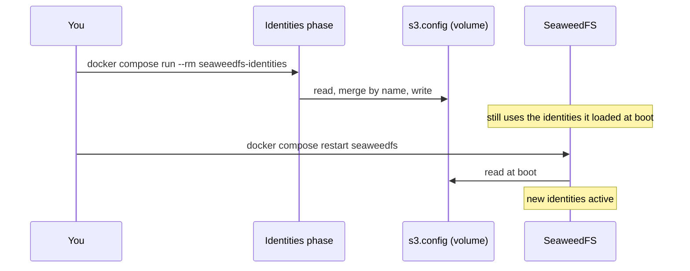

# Change identities on a running cluster

After this you can add an identity or change its keys or actions while SeaweedFS is running,
and know what in `s3.config` survives the change.

## When you need this

SeaweedFS is up, applications use it, and an identity has to change: a new application
needs keys, an existing one needs access to another bucket, or a key pair is replaced.
Editing the YAML and running the provisioner is not enough on its own, because SeaweedFS
doesn't notice the change until it restarts.

## What you need to know first

- **SeaweedFS reads `s3.config` only at boot.** The provisioner can't push an identity into
  a running SeaweedFS; it has no API for that. A changed file takes effect on the next
  restart. See [Why identities are a file](../concepts.md#why-identities-are-a-file).
- **The identities phase merges.** It reads `s3.config`, replaces each identity from the
  YAML by name (keys and actions together) or appends it, and writes the file back
  atomically. Everything else in the file stays. See
  [Additive by design](../concepts.md#additive-by-design).
- **The identities phase doesn't need SeaweedFS.** It only writes the file, so you can run
  it while SeaweedFS is running. See [Two phases](../concepts.md#two-phases).

The examples use the Docker Compose setup from
[Getting started](../getting-started.md#step-2-render-s3config-and-start-seaweedfs): the
services `seaweedfs-identities`, `seaweedfs` and `seaweedfs-provisioner`, and a named volume
that holds `s3.config` at `/seaweedfs-config/s3.json`. The identity `reports-app` gets read
access to a second bucket, `invoices`. The output was captured against
`chrislusf/seaweedfs:latest` (SeaweedFS 4.53) on 2026-11-15.

This is what happens, and when the change takes effect:



## Steps

### 1. Edit the identity in the YAML

Change the identity in `config.yaml`. Here `reports-app` gets `Read:invoices` and
`List:invoices`:

```yaml
  - name: reports-app
    credentials:
      - access_key: ${REPORTS_ACCESS_KEY}
        secret_key: ${REPORTS_SECRET_KEY}
    actions:
      - "Read:reports"
      - "Write:reports"
      - "List:reports"
      - "Read:invoices"
      - "List:invoices"
```

The YAML entry replaces the whole entry in `s3.config`. A credential or action you remove
from the YAML is removed from the file too.

### 2. Run the identities phase against the same volume

Run the identities service again. It mounts the same volume as SeaweedFS, so it rewrites the
file SeaweedFS will load:

```console
$ docker compose run --rm seaweedfs-identities
```

Output is trimmed; real lines also carry `time`:

```json
{"level":"INFO","msg":"Configuration loaded","phase":"identities","buckets":2,"identities":2,"policies":0}
{"level":"INFO","msg":"Using s3.config for identities","path":"/seaweedfs-config/s3.json","mode":"0644"}
{"level":"INFO","msg":"Provisioning identities","count":2}
{"level":"INFO","msg":"Writing identity","name":"admin"}
{"level":"INFO","msg":"Identity written","name":"admin","actions":1}
{"level":"INFO","msg":"Writing identity","name":"reports-app"}
{"level":"INFO","msg":"Identity written","name":"reports-app","actions":5}
{"level":"INFO","msg":"seaweedfs-provisioner finished successfully"}
```

Every identity in the YAML is written on every run, changed or not.

Use `--phase=identities`, not `all`. In `all`, the provisioner connects to the S3 gateway
first and writes `s3.config` only after that succeeds. If the gateway is down or rejects
the admin key, nothing is written, and the run retries for up to five minutes:

```json
{"level":"INFO","msg":"Configuration loaded","phase":"all","buckets":2,"identities":2,"policies":0}
{"level":"INFO","msg":"Using s3.config for identities","path":"/seaweedfs-config/s3.json","mode":"0644"}
{"level":"INFO","msg":"Connecting to SeaweedFS S3","endpoint":"http://seaweedfs:8333"}
{"level":"WARN","msg":"SeaweedFS S3 not ready, retrying","attempt":1,"max_retries":15,"delay":1000000000,"error":"operation error S3: ListBuckets, https response error StatusCode: 0, RequestID: , HostID: , request send failed, Get \"http://seaweedfs:8333/?x-id=ListBuckets\": dial tcp: lookup seaweedfs on 127.0.0.11:53: no such host"}
```

### 3. Restart SeaweedFS

Until the restart, SeaweedFS works with the identities it loaded at boot. `reports-app`
still can't list `invoices`:

```console
$ aws --endpoint-url http://localhost:8333 s3 ls s3://invoices/

aws: [ERROR]: An error occurred (AccessDenied) when calling the ListObjectsV2 operation: Access Denied.
```

A newly added key is rejected with `InvalidAccessKeyId` at this point. Restart SeaweedFS so
it reads the new file:

```console
$ docker compose restart seaweedfs
```

S3 requests fail while SeaweedFS restarts. With a single SeaweedFS container, plan the
restart for a moment when that is acceptable.

### 4. Run the cluster phase if buckets changed

If the change also added a bucket, run the cluster phase once SeaweedFS is healthy:

```console
$ docker compose run --rm seaweedfs-provisioner
```

## Check that it works

With `reports-app`'s keys in the environment, as in
[Give an application its own credentials](give-an-application-its-own-credentials.md), list
`invoices` again. The Compose file publishes port 8333:

```console
$ aws --endpoint-url http://localhost:8333 s3 ls s3://invoices/
2026-11-15 16:48:23         18 legacy.txt
```

To see what SeaweedFS loaded, print the file from the SeaweedFS container:

```console
$ docker compose exec seaweedfs cat /seaweedfs-config/s3.json
```

## Pitfalls

- **Extra fields on identities are dropped.** The merge keeps identities that are not in
  the YAML and unknown top-level keys such as `accounts`, but it writes every identity back
  with only `name`, `credentials` and `actions`. In the test, `s3.config` held a hand-made
  identity with an `account` field and a credential `status`:

  ```json
  {
    "identities": [
      {
        "name": "legacy-importer",
        "credentials": [{"accessKey": "legacy-key", "secretKey": "legacy-secret", "status": "Active"}],
        "actions": ["Write:invoices"],
        "account": {"id": "finance", "displayName": "Finance"}
      }
    ],
    "accounts": [
      {"id": "finance", "displayName": "Finance", "emailAddress": "finance@example.com"}
    ]
  }
  ```

  (trimmed: `admin` and `reports-app` omitted). After the identities phase, `accounts` and
  the identity are still there, but `account` and `status` are gone, and the top-level keys
  are in alphabetical order:

  ```json
  {
    "accounts": [
      {
        "id": "finance",
        "displayName": "Finance",
        "emailAddress": "finance@example.com"
      }
    ],
    "identities": [
      …
      {
        "name": "legacy-importer",
        "credentials": [
          {
            "accessKey": "legacy-key",
            "secretKey": "legacy-secret"
          }
        ],
        "actions": [
          "Write:invoices"
        ]
      }
    ]
  }
  ```

  If you rely on such fields, don't let the provisioner write that file.
- **Removing an identity from the YAML doesn't remove it from `s3.config`.** The provisioner
  never deletes identities. Edit `s3.config` by hand, for example with a one-off container
  that mounts the volume, and restart SeaweedFS.
- **A different volume or path.** If the identities service mounts another volume, or
  `SEAWEEDFS_S3_CONFIG_PATH` differs from the `-s3.config` path SeaweedFS is started with,
  the run succeeds and SeaweedFS never sees the change. The `path` in
  `Using s3.config for identities` must be the file SeaweedFS reads.
- **The identities phase needs the keys of every identity.** All `${…}` placeholders in the
  YAML are expanded on every run, so the identities container needs the environment
  variables for all identities, not only the one you changed. A missing one stops the run
  with `environment variable "<NAME>" is not set`, and `s3.config` stays as it was; see
  [Keep access keys out of the config file](keep-access-keys-out-of-the-config.md).

## Further reading

- [Why identities are a file](../concepts.md#why-identities-are-a-file) and
  [Additive by design](../concepts.md#additive-by-design).
- [Identities](../configuration.md#identities) in the configuration reference.
- [Rotate an access key without downtime](rotate-an-access-key.md).
- [FAQ: Identities and access](../faq.md#identities-and-access).
